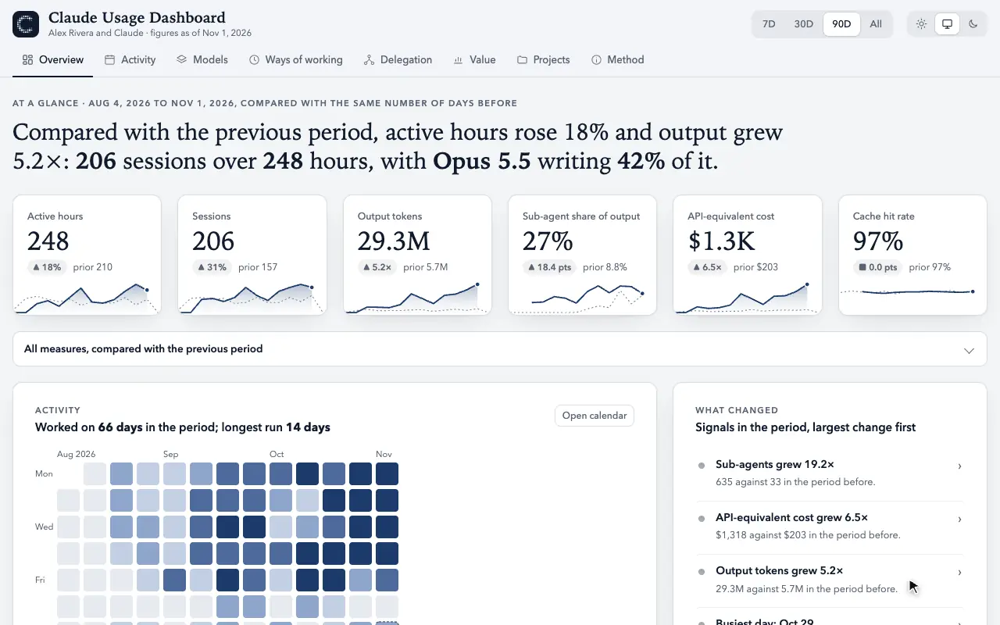
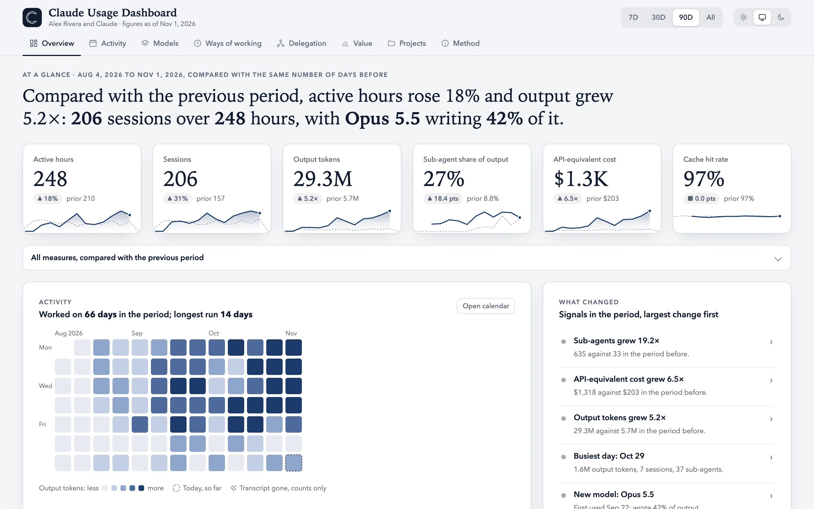
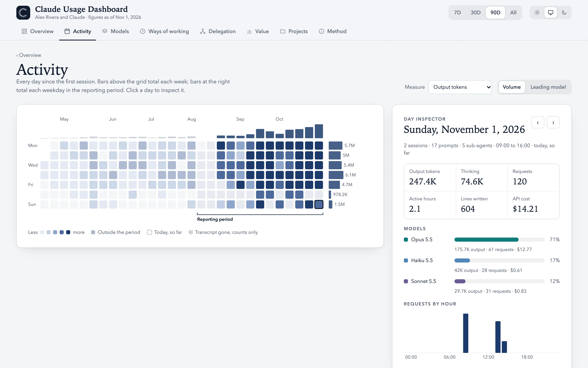
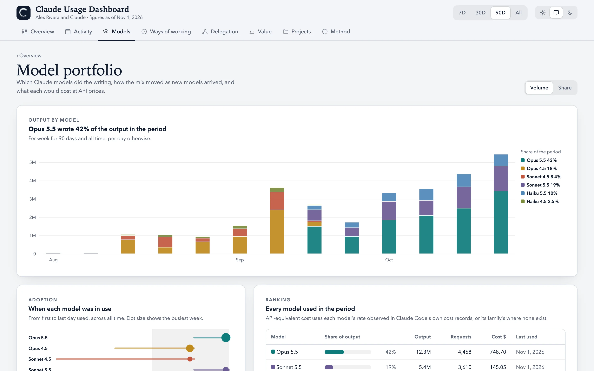
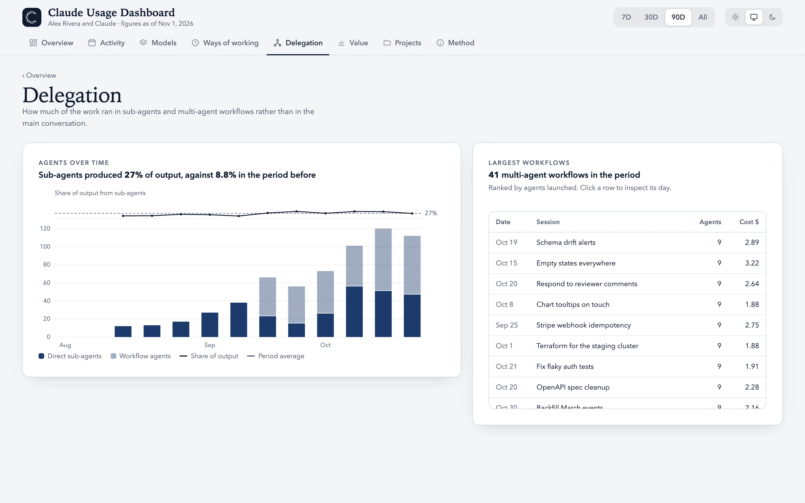
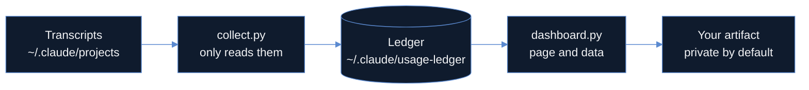

<div align="center">

<picture>
  <source media="(prefers-color-scheme: dark)" srcset="assets/logo-dark.svg">
  
</picture>

<h1>Claude Usage Dashboard</h1>

<p>Claude Code saves a transcript of every session on your disk and deletes it after 30 days by default.<br>
This plugin keeps the numbers from those transcripts and turns them into a private dashboard on claude.ai.</p>

<p>
<a href="https://github.com/LeoWarnow/claude-usage-dashboard/releases"></a>
<a href="LICENSE"></a>
<a href="https://code.claude.com/docs/en/plugins"></a>


<a href="https://github.com/LeoWarnow/claude-usage-dashboard/commits/main"></a>
</p>

<br>



<sub>Demo data</sub>

</div>

## Install

```text
/plugin install usage-dashboard --marketplace LeoWarnow/claude-usage-dashboard
```

Run `/reload-plugins`, then tell Claude to *set up my usage dashboard*. Claude reads your transcripts, publishes the dashboard as a private artifact in your claude.ai account and gives you the link. When it offers a nightly refresh, accept it to keep that link current.

You need Claude Code 2.1.275 or later, Python 3.9 or later, and a claude.ai account where Claude Code can create artifacts. Rather keep everything on your machine? `dashboard.py build` writes the same dashboard as a single HTML file instead ([details](#other-ways-to-install)).

## What you get

You pick a period: the last 7, 30 or 90 days, or all time. The Overview opens with one sentence about it, for example *"Compared with the previous period, active hours rose 18% and output grew 5.2×."* Below it are active hours, sessions, output tokens, the share of output written by sub-agents, API-equivalent cost and cache hit rate, each with its change against the previous period (all time has no comparison).

Behind the Overview are seven views:

| View | What it answers |
| --- | --- |
| Activity | Which days you worked, as a GitHub-style calendar. Click a day for its models, hours, lines written and cost. |
| Models | Which model wrote your output, week by week. |
| Ways of working | At which hours and on which weekdays you work, and which tools Claude used. |
| Delegation | How much of the work ran in sub-agents and multi-agent workflows. |
| Value | What the tokens would cost at API prices, and how much of your input came from the prompt cache. |
| Projects | Which project folders got the work, and when. |
| Method | How the numbers are computed. |

The dashboard follows Claude's light or dark theme, and you can pin either one.

<table>
<tr>
<td width="50%" valign="top">
<picture>
  <source media="(prefers-color-scheme: dark)" srcset="assets/overview-dark.webp">
  
</picture>
<p align="center"><sub>Overview</sub></p>
</td>
<td width="50%" valign="top">
<picture>
  <source media="(prefers-color-scheme: dark)" srcset="assets/activity-dark.webp">
  
</picture>
<p align="center"><sub>Activity</sub></p>
</td>
</tr>
<tr>
<td width="50%" valign="top">
<picture>
  <source media="(prefers-color-scheme: dark)" srcset="assets/models-dark.webp">
  
</picture>
<p align="center"><sub>Models</sub></p>
</td>
<td width="50%" valign="top">
<picture>
  <source media="(prefers-color-scheme: dark)" srcset="assets/delegation-dark.webp">
  
</picture>
<p align="center"><sub>Delegation</sub></p>
</td>
</tr>
</table>

## What gets published

Numbers and labels, no prompts and no code. The dashboard is a claude.ai artifact in your own account and stays private until you share it.

| In the dashboard | Stays on your computer |
| --- | --- |
| Tokens and requests per day and model, tool calls per day | Prompts and replies |
| Session titles and project folder names | File contents and diffs |
| Sub-agent task names | Credentials and settings |
| Active time per day and hour | Everything outside `~/.claude` and the Claude app's data folder |

Session titles are the short summaries Claude writes for each session, so they can name what you worked on. Keep that in mind before you share the link.

Two more things to know:

- **History starts 30 days before your first run**, because that is all Claude Code still keeps. From then on a ledger in `~/.claude/usage-ledger` records every day, even after the transcripts are deleted. The plugin does not change any Claude Code setting.
- **Cost means API list price.** On a subscription, that is not your bill.

## How it works



The plugin is two Python scripts (standard library only) and one skill. The skill tells Claude how to publish the dashboard with Claude's built-in artifact tools, so there is no server and no API key. The nightly refresh is a scheduled task in the Claude desktop app. In testing, one refresh took about two minutes and under 60,000 tokens. To combine usage from several computers, point the ledger at a folder they all sync.

## More

<details id="other-ways-to-install">
<summary><b>Other ways to install</b></summary>
<br>

From a terminal:

```bash
claude plugin install usage-dashboard --marketplace LeoWarnow/claude-usage-dashboard
```

Without the plugin system, paste this into Claude:

```text
Install the usage-dashboard skill from https://github.com/LeoWarnow/claude-usage-dashboard: clone the repository to a temporary folder, copy skills/usage-dashboard to ~/.claude/skills/usage-dashboard, then use that skill to set up my Claude usage dashboard.
```

To skip claude.ai, run this from the repository. It writes `~/.claude/usage-dashboard/standalone/claude-usage-dashboard.html`, which opens in any browser:

```bash
python3 skills/usage-dashboard/scripts/dashboard.py build
```

</details>

<details>
<summary><b>Update</b></summary>
<br>

```bash
claude plugin update usage-dashboard@warnow-tools
```

`warnow-tools` is the name of this repository's plugin marketplace. Restart Claude Code afterwards. The next refresh publishes the new version to the same link.

</details>

<br>

<div align="center">
<sub>MIT licence · Built by <a href="https://github.com/LeoWarnow">Leo Warnow</a> (and Claude of course)</sub>
</div>
